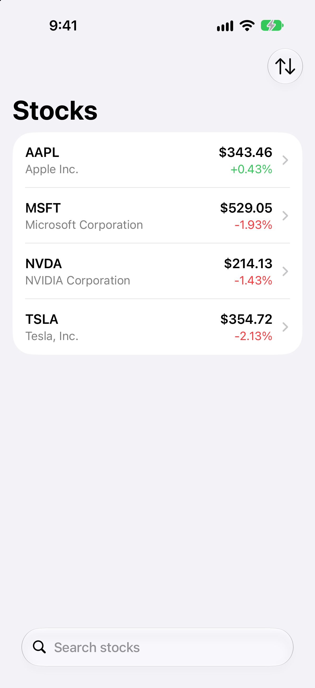
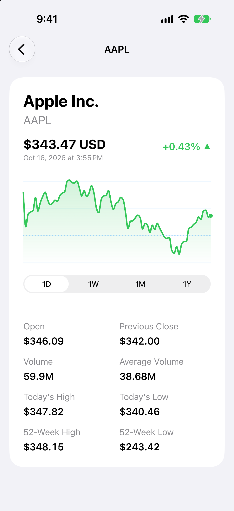

# StockTracker

StockTracker is a native iOS stock watchlist demo built to explore SwiftUI, Swift concurrency, networking, and testing.

  
  

## Features

- Search for stocks and manage a persistent watchlist
- View prices and daily percentage changes
- Sort by symbol, company name, or percentage change
- Open stock details with trading statistics and a smooth price chart
- Explore 1D, 1W, 1M, and 1Y price history
- Drag through the chart to inspect prices, dates, and percentage changes

The app runs with local mock data by default. No account or API key is required. Live data is available through
[Twelve Data](https://twelvedata.com/).

## Built With

- Swift and SwiftUI
- Observation and Swift concurrency
- Swift Charts
- URLSession for networking
- UserDefaults for watchlist persistence
- Swift Testing

The project targets iOS 26.4 or later.

## Running the Project

1. Clone the repository.
2. Open `StockTracker.xcodeproj` in an Xcode version that supports the deployment target.
3. Select the `StockTracker` scheme.
4. Choose an iPhone Simulator or configure signing for your device, then build and run.

Keep `usesMockData` set to `true` in `AppConfiguration.current` to use the included sample data.
For live quotes, search, and history, follow the [Twelve Data guide](https://github.com/samyanez94/StockTracker/wiki/Twelve-Data).

## Documentation

- [App Overview](https://github.com/samyanez94/StockTracker/wiki/App-Overview) — features, chart behavior, and current limits.
- [Architecture](https://github.com/samyanez94/StockTracker/wiki/Architecture) — state, persistence, and request flow.
- [Development](https://github.com/samyanez94/StockTracker/wiki/Development) — run, test, format, and verify the app.
- [Twelve Data](https://github.com/samyanez94/StockTracker/wiki/Twelve-Data) — live setup, API integration, mock data, and usage limits.
